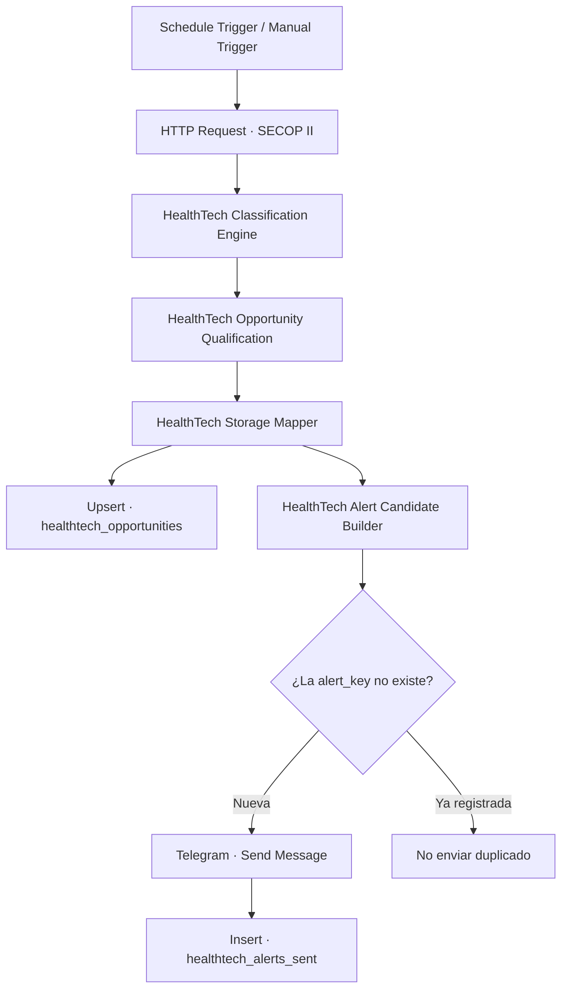
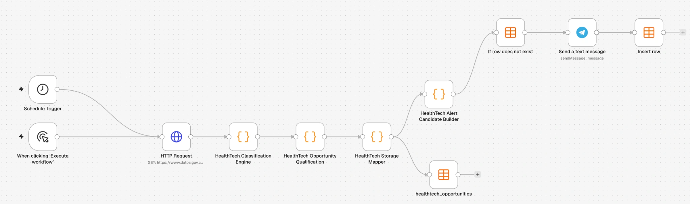

# HealthTech Procurement Radar

**Inteligencia automatizada de contratación pública para el sector salud en Colombia**  
Data Engineering · Automatización de workflows · n8n · Docker · JavaScript · SECOP II · Telegram

HealthTech Procurement Radar es un workflow autoalojado que consulta registros públicos de contratación de SECOP II, clasifica compras relacionadas con productos del sector salud, califica oportunidades comerciales, almacena los resultados y envía alertas por Telegram para nuevas candidatas de prioridad alta.

> **Estado del proyecto:** MVP funcional validado en un entorno local con Docker Desktop y n8n. Este repositorio documenta la implementación; no es un SaaS alojado ni un servicio de producción disponible 24/7.

## ¿Qué hace?

- Consulta un lote acotado de procesos desde la API Socrata de datos.gov.co.
- Clasifica registros mediante reglas JavaScript para productos e insumos del sector salud.
- Califica estado, relevancia comercial, prioridad, fechas y enlaces disponibles.
- Actualiza `healthtech_opportunities` mediante Upsert, usando `id_del_proceso` como clave de coincidencia.
- Construye candidatas de alerta y comprueba una clave compuesta en una segunda Data Table.
- Envía por Telegram las nuevas candidatas de prioridad alta.
- Inserta el historial después de que Telegram confirma el envío.

## Arquitectura

### Captura del workflow

El repositorio incluye un JSON importable y sanitizado en [`workflow/healthtech-procurement-radar.json`](workflow/healthtech-procurement-radar.json). Conserva la lógica y las conexiones de los nodos, pero elimina las credenciales vinculadas, el Chat ID del propietario, los metadatos de webhook y los IDs de Data Tables específicos de la instancia. El Chat ID de Telegram queda como marcador y debe configurarse después de importar.

## Resultados de validación

Son cifras de una ejecución de prueba, no métricas acumuladas de producción:

| Validación | Resultado |
|---|---:|
| Registros consultados | 100 |
| Compras de productos HealthTech filtradas | 8 |
| Alertas de prioridad alta enviadas | 3 |
| Alertas ya registradas bloqueadas en una ejecución posterior | 3 |

Las tres candidatas notificadas no tenían una fecha límite detectada en los datos de prueba. Por eso se marcaron para verificación en SECOP; el radar no afirma que estuvieran confirmadas como abiertas para presentar ofertas.

## Tecnologías

| Área | Tecnologías |
|---|---|
| Orquestación | n8n 2.45.7 |
| Runtime | Docker Desktop, Docker Compose |
| Transformación y calificación | JavaScript |
| Fuente e integración | SECOP II Open Data, datos.gov.co, Socrata REST API / SoQL |
| Persistencia | n8n Data Tables |
| Notificaciones | Telegram Bot API |
| Programación | Schedule Trigger de n8n, `America/Bogota` |

## Fuente de datos

**SECOP II - Procesos de Contratación**, conjunto de datos público suministrado por la Agencia Nacional de Contratación Pública - Colombia Compra Eficiente.

- Dataset: <https://www.datos.gov.co/d/p6dx-8zbt>
- API: <https://www.datos.gov.co/resource/p6dx-8zbt.json>
- Identificador: `p6dx-8zbt`

La fuente pública se actualiza de forma independiente. Antes de actuar sobre una oportunidad se deben verificar directamente en SECOP los campos, fechas límite y estado vigente del proceso.

## Tablas de datos

- `healthtech_opportunities`: almacena procesos normalizados y calificados. La operación Upsert compara por `id_del_proceso`.
- `healthtech_alerts_sent`: conserva el historial. `alert_key` combina identificador del proceso, estado del radar, prioridad de acción y fecha límite (o `SIN_FECHA`) para evitar repetir el mismo aviso.

## Ejecución local con Docker

Se incluye [`docker/docker-compose.example.yml`](docker/docker-compose.example.yml) como ejemplo limpio para una nueva instancia local. **No reemplaza la configuración ni el volumen Docker que ya usa el propietario.**

1. Instalar Docker Desktop.
2. Copiar `.env.example` como `.env` y revisar la zona horaria.
3. Iniciar el ejemplo con `docker compose -f docker/docker-compose.example.yml up -d`.
4. Abrir <http://localhost:5678> y completar la configuración inicial de n8n.
5. Crear la credencial Telegram desde la interfaz de n8n; no guardar el token en el código ni en GitHub.
6. Crear las dos Data Tables y configurar el workflow según la documentación.
7. Importar `workflow/healthtech-procurement-radar.json`, seleccionar la credencial Telegram propia, reemplazar `YOUR_TELEGRAM_CHAT_ID` y verificar los nombres de las dos Data Tables.

El Schedule Trigger está configurado para las 07:00 en `America/Bogota`. En ejecución local, el equipo anfitrión y el contenedor deben permanecer encendidos.

Consulta [`docs/local-setup.md`](docs/local-setup.md) y [`docs/security.md`](docs/security.md).

## Autor

**Jersson Yopasa** · Ingeniero industrial enfocado en Data Engineering, BI y automatización.  
GitHub: <https://github.com/ingjerssonyopasa-a11y> · Portafolio: <https://jyopasa.com>

[Read in English](README.md)
