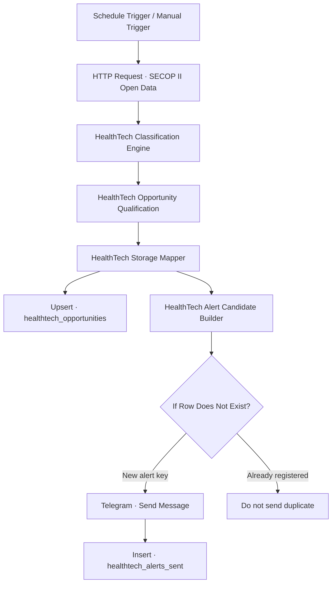
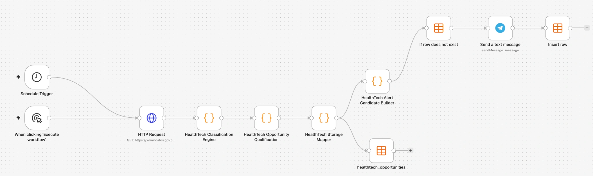

# HealthTech Procurement Radar

**Automated public-procurement intelligence for Colombia's healthcare sector**  
Data Engineering · Workflow Automation · n8n · Docker · JavaScript · SECOP II · Telegram

[](https://n8n.io/) [](https://www.docker.com/) [](https://developer.mozilla.org/en-US/docs/Web/JavaScript) [](https://www.datos.gov.co/d/p6dx-8zbt)

HealthTech Procurement Radar is a self-hosted automation workflow that retrieves public procurement records from Colombia's SECOP II open-data dataset, classifies healthcare-related purchases, qualifies commercial opportunities, stores the results, and sends Telegram alerts for new high-priority candidates.

> **Project status:** functional MVP validated in a local Docker Desktop + n8n environment. This repository documents the implementation. It is not a hosted SaaS or a 24/7 production service.

## What it does

- Retrieves a bounded batch of procurement records through the datos.gov.co / Socrata API.
- Classifies records using JavaScript rules for healthcare products and supplies.
- Qualifies records by procurement state, commercial relevance, priority, dates, and available links.
- Upserts product-purchase candidates into an n8n Data Table using `id_del_proceso` as the match key.
- Builds alert candidates and checks a composite `alert_key` against a second Data Table.
- Sends new high-priority candidates through the Telegram Bot API.
- Inserts a history row only after Telegram successfully sends the message.

## Workflow architecture



### Workflow screenshot



The repository includes a sanitized, importable workflow export at [`workflow/healthtech-procurement-radar.json`](workflow/healthtech-procurement-radar.json). It preserves node logic and connections while removing credential bindings, the owner's Telegram Chat ID, webhook metadata, and instance-specific Data Table IDs. The Telegram Chat ID is a placeholder and must be configured after import.

## Validation snapshot

The following figures come from a validation run, not cumulative production monitoring:

| Check | Result |
|---|---:|
| Procurement records retrieved | 100 |
| Healthcare product-purchase records filtered | 8 |
| High-priority Telegram alerts sent | 3 |
| Previously registered alerts blocked on a subsequent run | 3 |

The three notified candidates did not have a closing date detected in the test data. They were flagged for verification in SECOP; the workflow does **not** claim that they were confirmed open for bids.

## Technology stack

| Area | Technologies |
|---|---|
| Orchestration | n8n 2.45.7 |
| Runtime | Docker Desktop, Docker Compose |
| Transformation and qualification | JavaScript |
| Data source and integration | SECOP II Open Data, datos.gov.co, Socrata REST API / SoQL |
| Persistence | n8n Data Tables |
| Notifications | Telegram Bot API |
| Scheduling | n8n Schedule Trigger, `America/Bogota` |

## Data source

**SECOP II - Procesos de Contratación** is a public dataset provided by Colombia's Agencia Nacional de Contratación Pública - Colombia Compra Eficiente.

- Dataset page: <https://www.datos.gov.co/d/p6dx-8zbt>
- API endpoint: <https://www.datos.gov.co/resource/p6dx-8zbt.json>
- Dataset identifier: `p6dx-8zbt`

The workflow requests a bounded sample and applies filters to the fields available in the dataset. The public source is updated independently of this project; field availability, query behavior, and procurement states should be rechecked against SECOP before acting on an opportunity.

## Data tables

### `healthtech_opportunities`

Stores the normalized purchase candidates and qualification output. The stable process identifier `id_del_proceso` is used for Upsert matching.

### `healthtech_alerts_sent`

Stores sent-alert history. The composite `alert_key` uses the process identifier, radar state, action priority, and deadline (or `SIN_FECHA`) to avoid repeating the same alert state.

The alert is inserted into this table after Telegram reports a successful send.

## Run locally with Docker

A reference Docker Compose file is provided at [`docker/docker-compose.example.yml`](docker/docker-compose.example.yml). It is a clean example for a new local n8n instance, **not a replacement for the owner's existing Docker configuration or persistent volume**.

1. Install Docker Desktop.
2. Copy `.env.example` to `.env` and review the timezone settings.
3. Start the example instance:

   ```bash
   docker compose -f docker/docker-compose.example.yml up -d
   ```

4. Open <http://localhost:5678> and finish n8n's initial owner setup.
5. Add the Telegram credential in n8n's Credentials UI. Do not put the bot token in workflow code or this repository.
6. Create the two Data Tables and configure the workflow as described in `docs/`.
7. Import `workflow/healthtech-procurement-radar.json`, select your Telegram credential, replace `YOUR_TELEGRAM_CHAT_ID`, and confirm the two Data Table names.

The Schedule Trigger is configured for 07:00 in `America/Bogota`. On a local deployment, the host computer and Docker container must remain running for scheduled executions to occur.

More setup details: [`docs/local-setup.md`](docs/local-setup.md).

## Security and public-repository checklist

- Never commit a Telegram bot token, n8n credential export, personal Chat ID, `.env`, `.n8n` data directory, or private execution output.
- Store Telegram credentials in n8n's encrypted Credentials feature.
- Export the workflow only after reviewing the JSON and removing local IDs, private values, and unnecessary execution metadata.
- Use `.env.example` for placeholders only. Keep the actual `.env` local.
- Review screenshots for tokens, personal identifiers, and unrelated browser/UI content before committing them.

See [`docs/security.md`](docs/security.md).

## Repository contents

```text
healthtech-procurement-radar/
├── README.md
├── README.es.md
├── .gitignore
├── .env.example
├── docker/
│   └── docker-compose.example.yml
├── docs/
│   ├── architecture.md
│   ├── data-source.md
│   ├── local-setup.md
│   ├── results.md
│   ├── security.md
│   └── images/healthtech-workflow.webp
└── workflow/
    └── README.md
```

## Limitations and next steps

- Re-import and validate the sanitized workflow in a clean n8n instance before enabling its schedule.
- Consider pagination and a wider retrieval window for broader coverage.
- Validate closing dates and live procurement state directly in SECOP before commercial decisions.
- Move the local runtime to an always-on host only when operational availability is required.
- Add automated tests for classification rules and alert-key generation.

## Maintainer

**Jersson Yopasa** · Industrial Engineer focused on Data Engineering, BI, and Automation.  
GitHub: <https://github.com/ingjerssonyopasa-a11y>  
Portfolio: <https://jyopasa.com>
