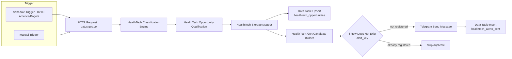

# Architecture

## End-to-end flow



## Node responsibilities

| Node | Responsibility |
|---|---|
| Schedule Trigger | Starts the daily run at 07:00, timezone `America/Bogota`. |
| Manual Trigger | Allows controlled manual executions and testing. |
| HTTP Request | Retrieves a bounded record set from the SECOP II open-data API. |
| HealthTech Classification Engine | Applies keyword/rule-based HealthTech classification and commercial type labels. |
| HealthTech Opportunity Qualification | Interprets procurement state, phase, dates, relevance, action priority, and available links. |
| HealthTech Storage Mapper | Selects product-purchase candidates and maps fields to the storage schema. |
| `healthtech_opportunities` Upsert | Inserts or updates a process by `id_del_proceso`. |
| HealthTech Alert Candidate Builder | Selects published high-priority candidates and builds a structured Telegram message. |
| If Row Does Not Exist | Checks `alert_key` against the alert history table. |
| Telegram Send Message | Sends the candidate message to the configured Telegram chat. |
| `healthtech_alerts_sent` Insert | Records the alert only after successful Telegram delivery. |

## Persistence model

### `healthtech_opportunities`

The primary match field is `id_del_proceso`. Other fields include procurement reference, entity, location, procedure name/description, state, phase, HealthTech category, commercial type, score, radar state, action priority, deadline, days to close, direct-link indicator, recommended action, estimated price, SECOP URL, and evaluation timestamp.

### `healthtech_alerts_sent`

The alert history includes:

- `alert_key` (string)
- `id_del_proceso` (string)
- `radar_estado` (string)
- `radar_prioridad_accion` (string)
- `radar_fecha_limite` (string)
- `fecha_alerta` (string)

The composite key pattern is:

```text
{id_del_proceso}|{radar_estado}|{radar_prioridad_accion}|{radar_fecha_limite-or-SIN_FECHA}
```

This allows a materially changed state, priority, or deadline to be treated as a new alert key.

## Operational boundary

The validated implementation runs locally in Docker Desktop. The Schedule Trigger is not a hosted availability guarantee: the Mac host and n8n container must be running at the scheduled time. A cloud/always-on deployment is a future improvement, not part of the validated environment.
